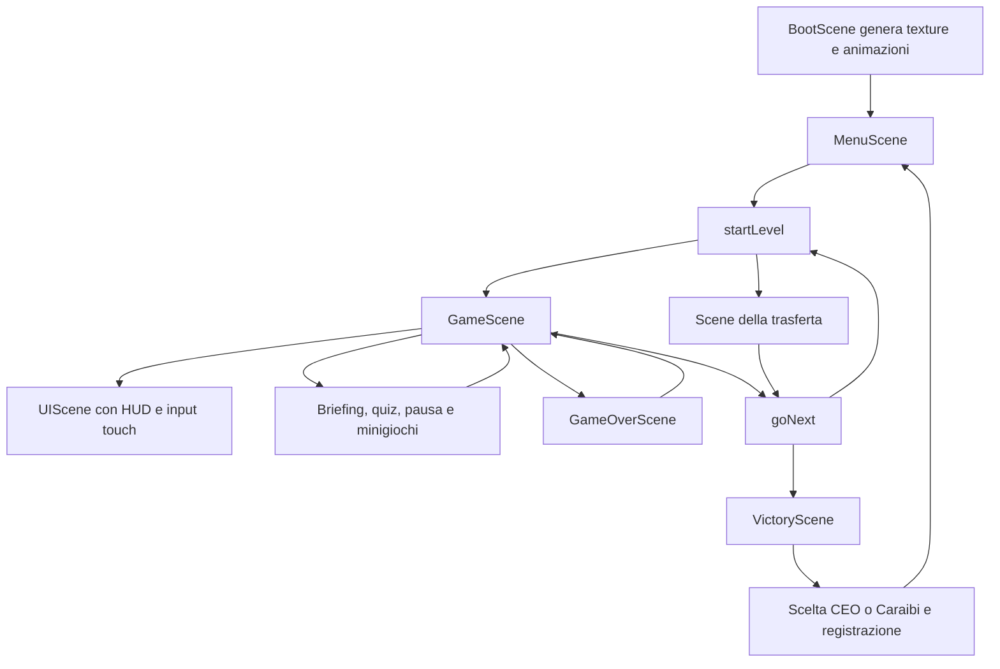

# Analisi del progetto

Baseline: versione **0.9.9**, commit `abceb61`, analisi del **15 novembre 2026**.

Corporate Odyssey è un'applicazione frontend statica. Il ciclo del gioco, i contenuti, la grafica e l'audio sono nel repository. L'unica integrazione remota applicativa individuata è l'invio facoltativo delle scelte finali a Google Apps Script; nella configurazione analizzata è disattivato.

## Organizzazione del codice

| Percorso | Responsabilità |
| --- | --- |
| `src/main.js` | Configura Phaser, registra le 23 scene, espone `window.__game` e avvia la PWA dopo READY |
| `src/config/constants.js` | Dimensioni, scala, chiavi di texture e animazioni, eventi, armi e metadati dei livelli |
| `src/state/GameState.js` | Singleton della partita, risorse, checkpoint e budget della trasferta |
| `src/scenes` | Menu, partita, interfaccia, overlay, minigiochi e finali |
| `src/systems` | Costruzione dei livelli, zone ambientali, armi, audio, trasferte, PWA e fullscreen |
| `src/entities` | Giocatore, nemici, boss, proiettili, pericoli e collezionabili |
| `src/levels` | Geometria e contenuti dei livelli, assemblati da `index.js` |
| `src/data` | Quiz, briefing, valigia, trasporti e clienti |
| `src/gfx` | Generazione procedurale di texture e animazioni |
| `src/ui` | HUD, joystick, pulsanti e interfaccia delle trasferte |
| `public` | Favicon e icone PWA |
| `.github/workflows/deploy.yml` | Build e pubblicazione su GitHub Pages |

Le immagini del gioco sono attualmente generate da primitive grafiche. Le icone PWA sono invece file PNG. L'audio di gioco è sintetizzato tramite Web Audio.

## Flusso di esecuzione

`GameScene.create()` costruisce sfondo, gruppi fisici, geometria, giocatore e sistemi prima di iniziare la partita. Gli oggetti grafici e i collider sono già distinti in diversi punti: per esempio `LevelBuilder.solid()` crea una superficie visiva e una zona fisica separata. Questa distinzione è utile per il porting HD.

Ogni aggiornamento legge l'input, applica eventuali blocchi, aggiorna pericoli e sistemi del livello, applica le zone ambientali e aggiorna il giocatore. Poi azzera l'ambiente temporaneo del giocatore, aggiorna armi e boss, decrementa il tempo, aggiorna l'HUD e controlla salute, timeout e cadute. L'intelligenza artificiale delle entità usa anche `preUpdate()` di Phaser.

## Stato della partita

- `hp` e `stress` sono limitati tra 0 e 100. A stress 100 i controlli si invertono; il burnout è determinato da salute esaurita o tempo scaduto.
- Euro e buoni pasto contribuiscono a `bonusProgress`: ogni 100 punti raccolti ripristinano 25 punti di salute.
- Un giorno di ferie crea un checkpoint nel livello. Dopo il burnout, ripartire da quel checkpoint consuma un giorno; i checkpoint speciali dei boss consentono un rientro gratuito.
- `device` abilita il tiro; `weapon` seleziona email, Teams, caffè, orologio o WWW.
- `pendingNext` conserva modificatori da applicare al livello successivo; `beginLevel()` li trasferisce e li consuma.
- `trip` conserva equipaggiamento, trasporto e budget della trasferta. Al termine, il budget residuo diventa un bonus in euro.

Lo stato della partita vive in memoria. Un ricaricamento della pagina non recupera la partita o i checkpoint. Il registro locale dei finali non è un sistema di salvataggio.

## Progressione

Le 19 voci di `LEVELS` includono livelli giocabili e tappe alternative: non rappresentano 19 livelli attraversati in sequenza in ogni partita.

| ID | Contenuto | Gestione |
| --- | --- | --- |
| 1-1 | Natale in Ufficio | GameScene, 5600 unità, 300 secondi |
| 1-2 | Estate d'Inferno | GameScene, caldo e aria condizionata |
| 2-1 | La Pausa Pranzo | Mensa e composizione del pasto |
| 3-1 | Il Limbo dei Post-it | Piattaforme temporanee e boss cliente |
| 4-1 | Il Cliente Lontano | Scelta destinazione, poi valigia |
| 4-2 | Il Mezzo | Scelta treno o aereo |
| 4-3 / 4-4 | Aeroporto / Stazione | Ramo dipendente dal trasporto |
| 4-5 / 4-6 | Volo / Treno | JourneyScene |
| 4-7 / 4-8 / 4-9 | Deserto / Ghiacciaio / Mare | Ramo dipendente dalla destinazione |
| 4-10 | Il Cliente | Negoziazione e fasi d'azione |
| 5-1 | Finance | Primo piano executive, minigioco ricavi |
| 5-2 | Risorse Umane | Salita executive |
| 5-3 | La Segreteria | Badge e accesso |
| 5-4 | L'Attico | Mega-Direttore, prime fasi |
| 5-5 | Il Tetto | Scontro finale e VictoryScene |

La valigia contiene inizialmente sei oggetti selezionabili, con fino a quattro posti extra acquistabili. `Trip.js` gestisce i rami: usare `startLevel()` e `goNext()` per le transizioni.

## Primo livello

`src/levels/level1_1.js` è la fonte della mappa: mondo largo 5600 unità, altezza logica 450, pavimento a y 386, partenza `[80, 386]`, uscita a `[5500, 386]`, limite di 300 secondi. Include scrivanie attraversabili dal basso, una scala, pozze di spumante, monete, buoni, caffè, laptop, ferie, aumento e promozione.

I nemici comprendono icone Teams, colleghi logorroici e festaioli, fotocopiatrici, armadi, bug, clienti, conf call e il collega «un minuto». Un terminale apre un quiz; la porta `partyDoor` apre il minigioco di ballo. Le coordinate dei contenuti restano la fonte operativa per il porting, anche quando l'aspetto cambia.

## Aspetti tecnici da affrontare

| Aspetto osservato | Implicazione |
| --- | --- |
| `pixelArt: true`, texture minute e CSS `image-rendering: pixelated` | Aumentare soltanto la risoluzione del canvas non aggiunge dettaglio; il porting richiede asset HD e un trattamento appropriato del filtraggio |
| `GAME_WIDTH` e `RENDER_SCALE` calcolati all'importazione | Un ridimensionamento successivo adatta la scala ma non ricalcola il layout logico; va progettato il comportamento durante resize e fullscreen |
| Touch UI basata su `device.input.touch`, zoom basato su `pointer: coarse` | Un browser desktop con capacità touch può mostrare i pulsanti anche con mouse e tastiera; serve una politica di input coerente |
| Precache limitato a JS, CSS, HTML e PNG | Se si introducono WebP, atlanti JSON o altri formati, la configurazione offline deve essere aggiornata |
| Generazione delle texture nel boot | Il passaggio ad asset esterni richiede caricamento, gestione degli errori e chiavi stabili |
| Nessuna suite di test o script lint/test nel package | Build e prove manuali sono le verifiche disponibili nella baseline |
| File vuoto `src/scenes/1` non importato | Residuo senza ruolo nel flusso analizzato |
| Nessun file di licenza individuato alla radice | La licenza di riuso non è dichiarata nel repository analizzato |

Questi sono punti di manutenzione e pianificazione, non una misura delle prestazioni. I concept non sono asset già separati, né una versione giocabile HD.

## Validazione della baseline

`npm ci --no-audit --no-fund` e `npm run build` sono riusciti. Vite ha trasformato 100 moduli; il bundle principale misura circa 1,93 MB, circa 490 kB gzip. Il service worker include 13 risorse per circa 1901 KiB.

Nel browser sono stati verificati menu, selezione del primo livello, briefing e ingresso nella partita. I log raccolti in questa sessione non riportavano errori o avvisi. Restano da verificare completamento di tutti i mondi, installazione/offline reali e fluidità su dispositivi fisici.
