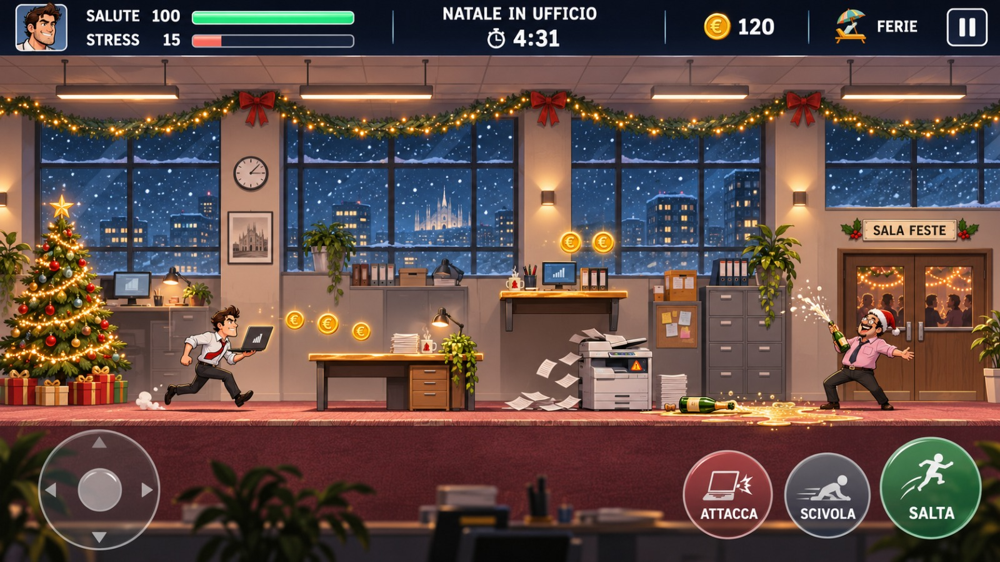

# Direzione artistica del primo livello

Il riferimento scelto dall'utente è **Ufficio cinematografico**. L'immagine allegata è conservata in [riferimento-approvato.png](concepts/riferimento-approvato.png) e prevale sulle alternative.

## Stile concordato

Platform 2D laterale con personaggi illustrati espressivi, contorni puliti e animazioni curate. L'ufficio ha materiali realistici, legno, vetro, tessuti e metallo; le luci natalizie calde contrastano con il blu della città innevata. Il mondo resta satirico: laptop, monete, fotocopiatrice, collega festaiolo e spumante conservano la loro funzione.

Il riferimento stabilisce stile, palette, proporzioni visive, atmosfera e qualità. I numeri del suo HUD sono illustrativi: il gioco deve mostrare lo stato reale. La sua composizione non sostituisce le coordinate della mappa originale.

## Cinque proposte esplorate

| Proposta | Carattere visivo | File |
| --- | --- | --- |
| 01 Ufficio cinematografico | Materiali credibili, personaggi illustrati e luci calde; direzione scelta | [PNG](concepts/01-ufficio-cinematografico.png) |
| 02 Fumetto corporate | Contorni più marcati, ombre nette, atmosfera fredda e satirica | [PNG](concepts/02-fumetto-corporate.png) |
| 03 Realismo atmosferico | Ambiente più realistico, materiali e profondità più pronunciati | [PNG](concepts/03-realismo-atmosferico.png) |
| 04 Diorama stop-motion | Miniature, materiali tattili e personaggi da animazione artigianale | [PNG](concepts/04-diorama-stop-motion.png) |
| 05 Noir natalizio | Bianco e nero con accenti rossi e dorati | [PNG](concepts/05-noir-natalizio.png) |

Le cinque tavole sono raccolte in [un PDF per il cliente](concepts/Corporate-Odyssey-proposte-grafiche.pdf). Sono concept generati con ImageGen, distinti dalle schermate della versione giocabile. I [prompt di generazione](concepts/PROMPTS.md) conservano le specifiche complete.

La prima integrazione risultava troppo distante dal concept nelle proporzioni: personaggi e oggetti erano piccoli rispetto al fondale. La revisione ravvicina la camera, arricchisce l'ufficio con postazioni arredate e aggiunge piante e scrivanie sfocate in primo piano. Le nuove schermate [PC](screenshots/livello-1-concept-pc.jpg) e [mobile](screenshots/livello-1-concept-mobile.jpg) mostrano il gioco realmente in esecuzione. Gli [arredi aggiuntivi](concepts/PROMPT-ARREDI-CONCEPT.md) sono generati dal solo riferimento approvato.

Le catture della prima integrazione sono conservate per confronto: [PC precedente](screenshots/livello-1-pc.jpg), [mobile precedente](screenshots/livello-1-mobile.jpg), [fullscreen precedente con Wendy](screenshots/livello-1-fullscreen.jpg).

## Porting su browser PC e mobile

Lo stile scelto è compatibile con una produzione basata su fondali e sprite 2D. La fluidità effettiva dipenderà da risoluzione, atlanti, memoria, effetti e dispositivo; deve essere misurata sul gioco implementato.

La strategia prevista usa fondali a più piani, illuminazione dipinta negli asset, superfici modulari, sprite animati separati e un numero contenuto di particelle. La foto completa del concept non va impiegata come unico fondale: contiene personaggi, HUD, oggetti e geometria che devono rimanere indipendenti.

Su PC i controlli touch sono nascosti e non occupano spazio; l'interfaccia conserva HUD, pausa e accesso al fullscreen. Su telefono in orizzontale compaiono joystick e azioni, con aree compatibili con notch e barre del sistema. Il rendering deve adattarsi al dispositivo senza cambiare la fisica.

## Materiali per l'implementazione

Il [prompt operativo del porting](PROMPT_PORTING_LIVELLO_1.md) definisce ambito, file da studiare, asset richiesti, controlli, fullscreen, gestione della risoluzione e criteri di accettazione. Le alternative 02-05 restano materiale di confronto e non fanno parte dello stile da implementare.

Gli [asset del porting](concepts/PROMPTS-ASSETS.md) seguono il solo riferimento approvato. La [guida tecnica HD](PORTING_HD.md) descrive come sono integrati nel gioco.
