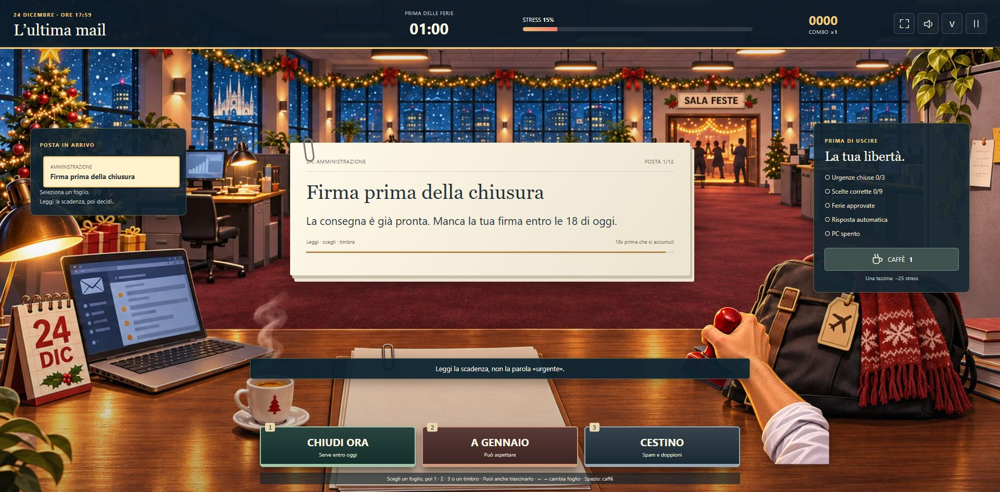
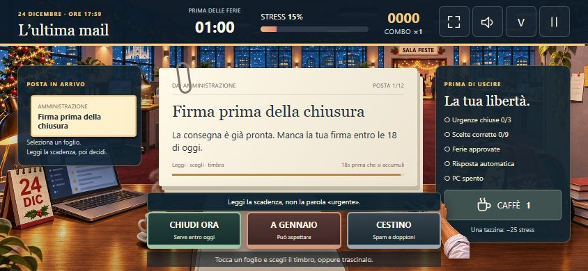
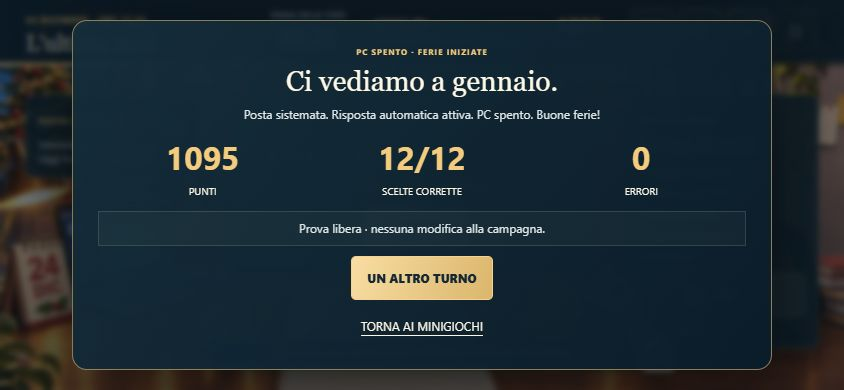

# L’ultima mail — ultimo minuto prima delle ferie

Revisione locale del 23 novembre 2026. Il bonus natalizio con il timbro **A GENNAIO** torna nel menu come prova libera. Il gesto ora richiede una decisione: gestire una scadenza reale, rimandare una richiesta non urgente oppure eliminare spam e doppioni.

## Accesso e integrazione

- Menu principale → minigiochi → **L’ultima mail**.
- Raccolta `?bonus=all`: nona voce, anche con il tasto 9.
- Apertura diretta: `?bonus=last-mail`.
- `&controls=touch` forza il layout touch; resta compatibile anche `&touch=1`.

La nuova voce è dichiarata in `MenuBonusCatalog.js`, separata dagli otto ingressi della campagna. Non sostituisce **Questa call poteva essere una mail**, che resta il gioco di carte. In questa revisione L’ultima mail è disponibile dal menu e in anteprima: il vecchio PC di accesso nello stage 1-1 non è stato riattivato.

Le prove libere non cambiano salute, stress, soldi, checkpoint o giorni di ferie della campagna. Il codice storico dei premi resta disponibile in `LastMailScene`, ma non è esposto da un nuovo ingresso della storia.

## Obiettivo e regole

È il 24 dicembre, ore 17:59. Hai **60 secondi** per sistemare **12 richieste** e lasciare l’ufficio.

| Destinazione | Quando usarla | Esempio |
| --- | --- | --- |
| CHIUDI ORA | Scadenza reale di oggi, pratica già pronta | Il corriere aspetta la conferma del ritiro |
| A GENNAIO | Richiesta che può aspettare il rientro | Presentazione del 15 gennaio, anche se il capo scrive URGENTISSIMO |
| CESTINO | Spam, doppioni e messaggi senza un’azione necessaria | Catena di auguri, newsletter pubblicitaria |

Le prime tre richieste mostrano i tre casi; le altre nove cambiano ordine a ogni partita. Arriva un foglio ogni quattro secondi nella prima parte e ogni tre nella seconda. La scrivania contiene al massimo tre richieste; ciascuna rimane disponibile per 18 secondi. Si può cambiare il foglio selezionato per decidere le priorità.

Una scelta corretta riduce lo stress di 3 e vale 35 punti per le urgenze o 25 per le altre richieste, moltiplicati dalla combo. Il moltiplicatore sale ogni tre scelte corrette consecutive, fino a ×4. Errori e richieste scadute azzerano la combo: costano 22 stress per le urgenze reali, 12 negli altri casi. Un solo caffè riduce lo stress di 25.

Per ottenere le ferie servono almeno **9 scelte corrette, comprese 3 delle 4 urgenze reali**. Quando tutta la posta è stata processata, la scrivania passa a due azioni esplicite:

1. Attivare la risposta automatica: «Sono in ferie. Torno a gennaio.»
2. Spegnere il PC prima che il minuto finisca.

Il solo possesso delle ferie non conclude il gioco. La vittoria arriva dopo lo spegnimento e aggiunge 150 punti; scadenza del tempo, 100 stress o obiettivi insufficienti fanno perdere. Timbrare tutto A GENNAIO non è una strategia vincente. Il riepilogo mostra punti, scelte corrette ed errori.

## Comandi e accessibilità

| Azione | PC | Touch |
| --- | --- | --- |
| Scegliere un foglio | Clic sulla posta, frecce sinistra/destra | Tocco sulla posta |
| Decidere | Pulsanti o tasti 1, 2, 3 | Pulsanti CHIUDI ORA, A GENNAIO, CESTINO |
| Spostare fisicamente un foglio | Trascinare la richiesta sulla destinazione | Stesso gesto con il dito |
| Caffè | Spazio o pulsante | Pulsante CAFFÈ |
| Risposta automatica / spegnimento | Pulsante o Invio | Pulsante nella schermata centrale |
| Pausa | P, Esc o pulsante | Pulsante pausa |
| Schermo intero / audio | F / M o pulsanti | Pulsanti, secondo il supporto del browser |

Il tocco sul foglio lo seleziona: non lo risolve automaticamente. Se un foglio scade durante il trascinamento, il gesto viene annullato. La pausa ferma timer e scadenze, impedisce azioni di gioco e conserva la selezione. Perdita del focus, scheda nascosta e rotazione verticale su touch mettono in pausa; il ritorno in orizzontale richiede una ripresa esplicita.

I pulsanti hanno etichette leggibili; gli esiti corretti ed errati sono spiegati con testo, oltre al colore. Le finestre gestiscono il focus da tastiera; l’impostazione di sistema per il movimento ridotto disattiva animazioni CSS e spostamento della mano.

## Grafica, audio e prestazioni

Riutilizzati il fondale natalizio illustrato `office.webp` e l’atlante trasparente `stamp-frames.webp`, senza nuovi asset generati. Il timbro mantiene quattro pose illustrate, con movimento interpolato fra preparazione, impatto e recupero. Fogli, ricevute e monitor finale sono elementi DOM nitidi, con composizione adattata a desktop e telefono in orizzontale.

Nessun servizio remoto è necessario per giocare. Le battute italiane esistenti restano locali; la battuta A GENNAIO si attiva solo quando quella destinazione è corretta. Il caffè e la vittoria usano le registrazioni esistenti; i volumi e il muto sono condivisi con il gioco. Il getter `round.paused` raccorda la pausa al direttore audio.

La lista visibile è limitata a tre richieste. I nodi della posta vengono riutilizzati finché la richiesta resta presente; il contenuto del foglio viene ricostruito solo al cambio di selezione o obiettivo.

## File principali

- `src/systems/LastMailRound.js`: contenuti delle richieste, ordine, regole, scadenze, scelte, finale e premio singolo.
- `src/ui/LastMailView.js` e `last-mail.css`: scrivania, trascinamento, tastiera, touch, finestre e animazione.
- `src/scenes/LastMailScene.js`: ciclo di vita, anteprima e ritorno alla raccolta.
- `src/bonus/MenuBonusCatalog.js`: voce aggiuntiva per il menu, senza ingresso implicito nella campagna.
- `src/menu/MenuModel.js`, `GameMenu.js`, `BonusHubScene.js`, `BootScene.js`, `main.js`: percorsi di avvio e registrazione.
- `tests/last-mail.test.js`: sei verifiche delle regole e della separazione fra menu e campagna.

## Verifica

Superati 22 test di regole, menu e audio, più due controlli mirati di catalogo e pausa dei modelli condivisi:

```powershell
node --test tests/last-mail.test.js tests/menu.test.js tests/audio.test.js
node --test --test-name-pattern="eight campaign|all seven" tests/new-minigames.test.js
```

Il percorso corretto è verificato a 30, 60 e 120 aggiornamenti al secondo. Coperti anche errori, requisito delle urgenze, caffè singolo, pausa, ritardi di scheda sospesa, scadenza durante il finale e premi non ripetibili.

Collaudo browser: partita completata con 12 scelte corrette e due azioni finali, timeout, riprova, ritorno alla raccolta, apertura della nona voce, trascinamento con feedback di errore, pausa/ripresa e rotazione. Layout verificato a 844×390; non equivale a un collaudo prestazionale o multitouch su telefono fisico.

Build Vite/PWA in una cartella separata, `E:\Repos\max\corporate-odyssey-last-mail-preview-20261123`. Rimane l’avviso sulla dimensione del bundle generale, che include anche modifiche contemporanee ad altri giochi. Nessun push o pubblicazione remota effettuato da questa revisione.

Anteprima locale: [L’ultima mail](http://localhost:49765/?bonus=last-mail), disponibile mentre il processo preview resta avviato.






