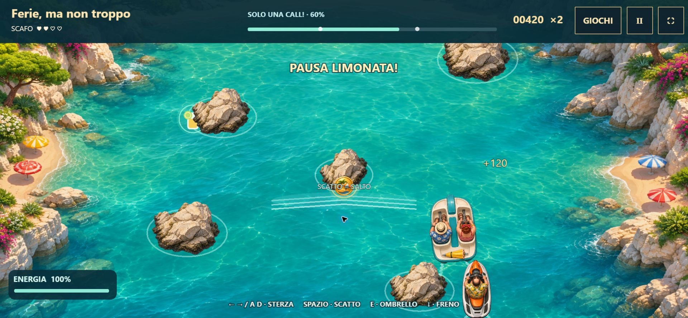
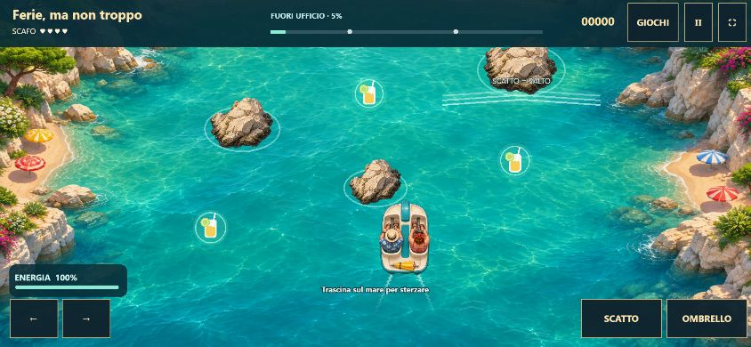

# Ferie, ma non troppo — fuga arcade in pedalò

Aggiornamento locale: 23 novembre 2026. Bonus di Estate d’Inferno (1-2), disponibile anche dal menu dei minigiochi e con `?bonus=pedalo`.

## Esperienza

La caletta mediterranea HD occupa tutta l’area di gioco. Pedalò e passeggeri sono più grandi; scie, riflessi, spruzzi, rollio, salti e ombre danno movimento alla scena. Il fondale scorre lentamente durante l’avvicinamento alla destinazione. Gli atlanti illustrati esistenti vengono riutilizzati, senza aggiungere download di nuovi fondali o personaggi.

La fuga segue tre momenti: **Fuori ufficio**, **Solo una call!**, **Ultima tacca**. Il capo arriva in moto d’acqua; un drone consegna urgenze. Gli attacchi mostrano in anticipo dove colpiranno e possono essere evitati o respinti con l’ombrellone.

- Bibite: ricaricano lo scatto. I gettoni ferie assegnano più punti.
- Onde: attraversate con lo scatto, fanno saltare il pedalò sopra gli scogli successivi. Ogni onda funziona una sola volta.
- Combo: raccolte, salti, schivate ravvicinate e call respinte aumentano il moltiplicatore fino a ×3. Un urto interrompe la combo.
- Scafo: quattro colpi disponibili, con una breve invulnerabilità dopo ciascun urto. L’ombrellone non protegge dagli scogli.
- Arrivo: la caletta senza campo conclude la fuga. Il riepilogo mostra punti, combo, raccolte, salti e call respinte.

Il punteggio arcade resta interno al bonus. La ricompensa della campagna rimane quella esistente (`hp: 10`, `stress: 10`, `euro: 15`), assegnata solo dopo una vittoria attraverso il servizio condiviso dei premi. Anteprima, pausa, riprova e ritorno allo stage conservano il ciclo di vita comune dei minigiochi.

## Comandi

| Azione | Tastiera | Telefono in orizzontale |
| --- | --- | --- |
| Sterzare | Frecce sinistra/destra oppure A/D | Frecce o trascinamento sul mare |
| Scatto / salto sulle onde | Spazio | SCATTO |
| Difesa dalle urgenze | E | OMBRELLO |
| Frenare | Freccia giù / S | Nessun pulsante dedicato |
| Pausa | P / Esc oppure pulsante in alto | Pulsante in alto |
| Schermo intero | F oppure pulsante in alto | Pulsante in alto, se supportato |

Su desktop i pulsanti di movimento sono nascosti. `?bonus=pedalo&controls=touch` consente di controllare il layout touch anche da desktop. La pausa blocca anche le animazioni basate sul tempo della partita e azzera gli input trattenuti.

## Implementazione

- `src/bonus/new/PedaloEscape.js`: modello a passo fisso, percorso, risorse, salti, attacchi, punteggio e coda limitata degli effetti.
- `src/bonus/PedaloPresentation.js`: presentazione dedicata, HUD, menu, effetti e guida con puntatore. Gli oggetti grafici vengono riutilizzati dalla scena.
- `src/scenes/StageBonusScene.js`: selezione della presentazione del pedalò all’interno del ciclo di vita condiviso.
- `src/bonus/StageBonusCatalog.js`: descrizione e istruzioni aggiornate nel catalogo.

Il caricamento del bonus richiede soltanto gli atlanti e il fondale che usa. Gli effetti non richiedono shader, video o un motore fisico aggiuntivo. I passeggeri sono integrati nello sprite illustrato del pedalò: non sono stati introdotti nuovi cicli di gambe o braccia per loro.

## Parametri di bilanciamento

| Parametro | Valore attuale |
| --- | --- |
| Percorso | 3600 unità, con cambi di fase a 1050 e 2450 |
| Scafo / protezione dopo un urto | 4 colpi / 1,5 secondi |
| Velocità obiettivo | 92 normale, 164 scatto, 72 ombrellone, 45 freno |
| Energia | Massimo 100; +15/s a riposo, −25/s in scatto, −12/s con ombrellone |
| Raccolte | Bibita +27 energia e 60 punti base; ferie +12 energia e 120 punti base |
| Salti | 4 onde, 1,15 secondi in aria; 100 punti base |
| Combo | ×1, ×2 dal terzo evento, ×3 dal sesto; un urto azzera la sequenza |
| Attacchi | Drone dopo 1300 unità; call del capo dopo 1850 |
| Limite del tentativo | 95 secondi di gioco attivo |

Le onde sono derivate dagli scogli del percorso e poste 90 unità prima del rispettivo ostacolo. Quando si modifica durata del salto, velocità o geometria del percorso, eseguire il test che verifica il superamento completo di ciascuno dei quattro scogli.

## Verifica

Cinque test dedicati superati in `tests/pedalo-arcade.test.js`: completamento del percorso con input a 30/60/120 Hz, pausa, raccolta singola e limiti energia, salto e invulnerabilità, difesa/schivata degli attacchi, posizione delle quattro onde rispetto ai rispettivi scogli. Superato anche il test preesistente del pedalò in `tests/new-minigames.test.js`.

```powershell
node --test tests/pedalo-arcade.test.js
node --test --test-name-pattern=pedalo tests/new-minigames.test.js
```

Build di produzione riuscita in una directory di anteprima separata dal `dist` condiviso. Rimane l’avviso Vite sul bundle generale oltre 2 MB; questa modifica non interviene sulla suddivisione dell’intera applicazione. Il collaudo riguarda il bonus; non certifica le modifiche contemporanee degli altri minigiochi.

Verifica browser: introduzione, gioco, scatto, ombrellone, schermata di sconfitta, riprova, pausa e ritorno al catalogo; layout desktop e viewport 844×390 con comandi touch. Nessun errore o avviso della console nelle sessioni controllate. Il viewport simulato non misura prestazioni, temperatura o multitouch su un telefono fisico.

Schermate del gioco, non concept:





L’anteprima locale preparata per questa revisione è `http://localhost:49763/?bonus=pedalo`, disponibile finché il relativo processo Vite preview rimane avviato. La build si trova nella cartella esterna `E:\Repos\max\corporate-odyssey-pedalo-preview-20261123`; non è inclusa nel commit dei sorgenti.

Consegna di questa revisione: codice, test, documentazione e schermate in Git locale. Nessun push o pubblicazione remota.
