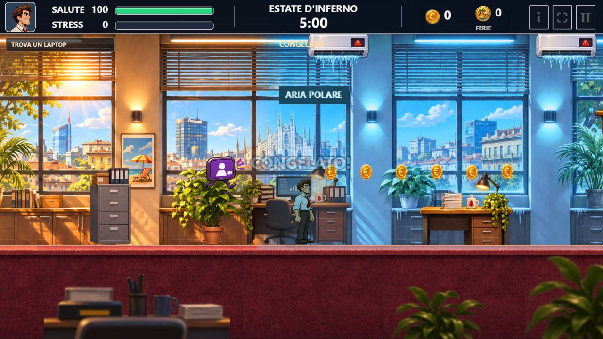
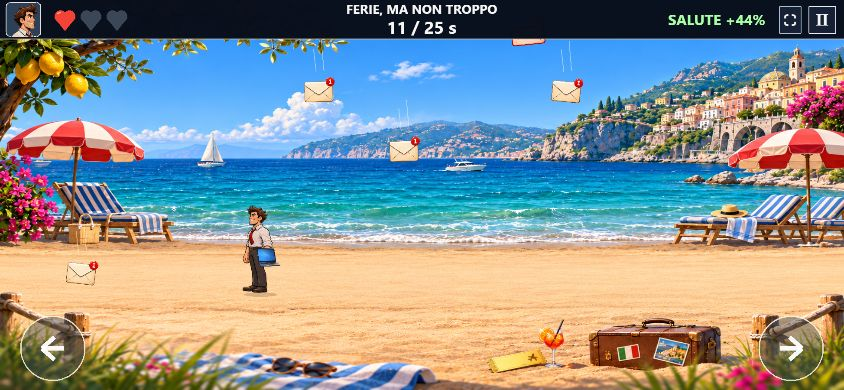

# Estate d'Inferno — porting HD locale

Implementazione del 22 novembre 2026 dei due [concept approvati](concepts/ESTATE-INFERNO.md): **1-2 Estate d'Inferno** e **Ferie, ma non troppo**. Questa iterazione riguarda soltanto questi due ambienti. Nessun push o pubblicazione.

## Avvio

```powershell
npm run dev
```

Aprire `http://localhost:8080/`, scegliere Jack o Wendy e lo scenario **Estate d'Inferno**. Il biglietto aereo dorato conduce al bonus. Per provarlo senza una partita: pulsante **BONUS FERIE** nel menu oppure `/?bonus=beach`. L'anteprima non assegna ricompense alla campagna.

PC: frecce/A-D nel bonus, P/Esc per pausa, F o pulsante per fullscreen. I comandi touch compaiono con il tocco; nella spiaggia sono soltanto le frecce destra/sinistra. Il livello conserva salto, scivolata e attacco. `?controls=touch` forza il layout per il collaudo; `?graphics=classic` conserva il rendering originale.

## Grafica e componenti riutilizzabili

- `AssetPacks.js` separa fondali dell'ufficio, atlas estivo condiviso e fondale della spiaggia. I nuovi file vengono richiesti solo entrando nella scena pertinente; Phaser riutilizza le texture già caricate. La PWA continua invece a precaricare gli asset per l'uso offline.
- `OfficePresentation` accetta anche `summer-hd`: riusa personaggi, otto frame di corsa per Jack/Wendy, scrivanie, piattaforme, arredi, HUD, controlli e gestione della risoluzione.
- `SummerAtmosphere` associa il contrasto ambra/ghiaccio alle zone effettive del livello. Due fondali registrati, con una breve sfumatura ai confini, mantengono lo stesso edificio; condizionatori, ventilatori, valigie, brina e particelle limitate completano la scena. Gli emettitori lontani dalla camera interrompono l'emissione.
- `BeachPresentation` separa lo scenario dalle mail, dai personaggi e dall'interfaccia. Riusa gli atlas animati, i ritratti, la politica d'input e il viewport HD. La proiezione visiva adatta la simulazione originale al nuovo fondale, mantenendo i suoi limiti e le collisioni.
- `CharacterPortraits` centralizza i ritratti comuni; `BeachRules` rende verificabili durata e premi. Nessuna nuova copia di Player o della fisica.

I concept non sono usati come screenshot statici del gioco. Gli asset di scenario non contengono HUD, personaggi o pickup; queste parti vengono renderizzate separatamente e seguono lo stato della partita. La composizione segue la geometria giocabile originale, quindi non replica le coordinate illustrative di ogni oggetto nella tavola.

## Meccaniche e ciclo di vita

Geometria di `level1_2.js`, nemici, timer, buche, raccolte e zone conservati. Il biglietto resta nel percorso originale e si può raccogliere una sola volta.

Il bonus conserva **tre vite**, **25 secondi**, mail progressivamente più frequenti/veloci e un secondo di invulnerabilità dopo un colpo. Ogni secondo completo vale quattro punti di salute, fino a 100; lo stress scende di un punto per secondo completo, fino a 25. Il premio si applica una sola volta all'uscita dalla prova di campagna, mai nell'anteprima.

Durante la spiaggia GameScene e la sua UI restano sospese. Al ritorno riprendono punto, timer e inventario; i comandi mantenuti vengono puliti. La pausa dedicata sospende anche introduzione, animazioni e cronometro del bonus. Il tempo di simulazione non include quello trascorso in pausa; i delta dopo sospensioni sono limitati. La chiusura libera skin, listener e viewport dell'anteprima.

## Asset e risorse

File in `public/assets/hd-summer/`: `office-background.png`, `office-cold.png`, `beach-background.png`, `summer-props.png`, `summer-props.json`. Gli otto ritagli dell'atlas sono condizionatore, ventilatore, biglietto, porta USCITA, mail, mail urgente, collega infreddolito e valigia.

PNG generati con **ImageGen integrato**, senza ritocchi manuali dei pixel. [Prompt esatti e riferimenti](concepts/PROMPTS-ASSET-ESTATE.md). Lo script `python scripts/build-hd-atlases.py` rigenera i soli rettangoli JSON leggendo l'alpha. Ogni file immagine resta sotto 5 MiB e 4096 pixel per lato. La densità del canvas mantiene i limiti già adottati: massimo 2,5 su touch e 3 su PC. Il bundle Phaser è separato dal codice applicativo per il caching.

## Verifiche

```powershell
node --test tests/hd-assets.test.js tests/last-mail.test.js tests/summer-hd.test.js
npm run build
git diff --check
```

12 test superati: integrità dei frame, animazioni dei due personaggi, pacchetti estivi, limiti dei file, premi della spiaggia e regressioni di L'ultima mail. Build Vite e generazione PWA riuscite.

Collaudo nel browser locale: caricamento senza errori di console, movimento e stati di freddo, raccolta del biglietto e ingresso nella prova di campagna, perdita delle vite, premio e ritorno all'ufficio con timer conservato; anteprima senza premio e ritorno al menu; pausa/ripresa con tempo e mail invariati durante la pausa; pulsanti sinistro e destro a 844×390. Schermate PC a 1280×720. La lettura diagnostica locale del livello ha mostrato circa 60 FPS: non è una misurazione su un telefono fisico.

Per raggiungere rapidamente una sezione in sviluppo, `?level=1&inspectX=1480` imposta solo il punto iniziale della prova locale. `inspectX` è protetto da `import.meta.env.DEV`, non assegna un checkpoint e non funziona nella build di produzione. Le schermate del contrasto usano questo posizionamento di collaudo.





Resta da eseguire il collaudo su dispositivi fisici Android/iOS per consumo, memoria, safe area reali e comportamento del fullscreen specifico del browser. Gli altri livelli mantengono la grafica precedente; i rispettivi bonus restano nella [matrice di proposte](BONUS_PER_LIVELLO.md).
