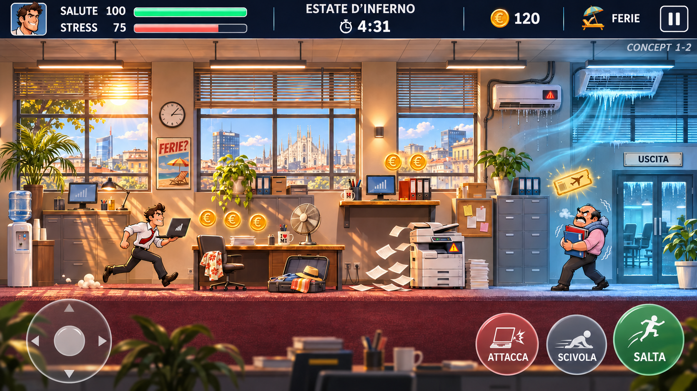
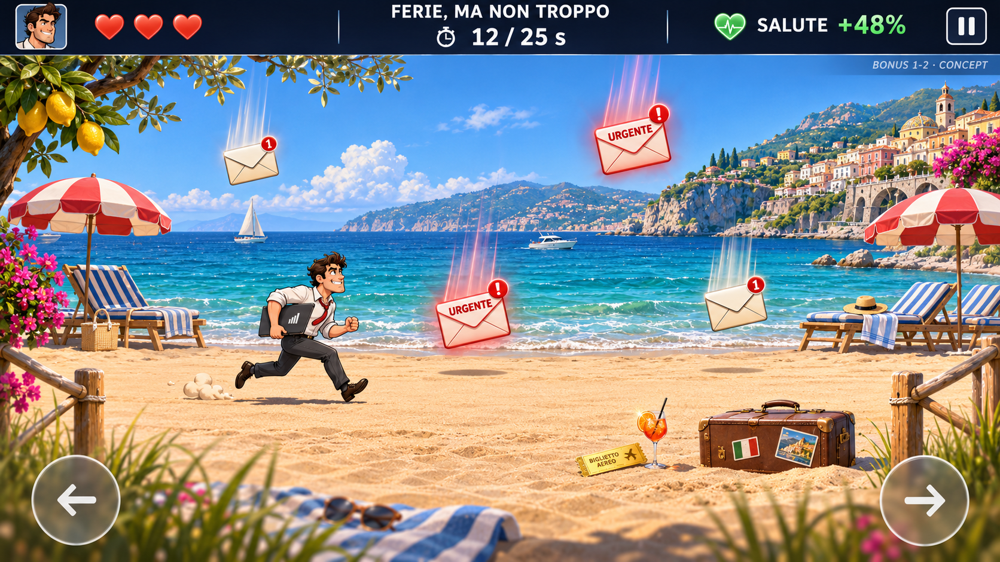

# Estate d'Inferno e Ferie, ma non troppo

Concept del 22 novembre 2026, preparati con ImageGen integrato a partire dal riferimento approvato del primo livello. Le tavole mostrano la direzione visiva proposta prima dell'implementazione. Non sono catture del gioco; numeri dell'HUD, disposizione degli oggetti e inquadrature sono illustrativi.

## Livello 1-2 — Estate d'Inferno

Lo stesso ufficio del mondo di Jack e Wendy, in agosto: sole attraverso le veneziane, città estiva, piante, scrivanie attrezzate, ventilatori e distributore d'acqua. Il caldo ambra contrasta con l'azzurro della zona gelata dal condizionatore. Il biglietto aereo collega il percorso al bonus.

Nell'implementazione gli asset saranno separati e collocati sulle coordinate effettive di `level1_2.js`, comprese le buche e tutte le zone calde/fredde, non necessariamente visibili in questa singola inquadratura. La porta indica USCITA. Su PC i comandi mobili saranno nascosti; il concept mostra la variante touch.

## Bonus 1-2 — Ferie, ma non troppo

Una spiaggia italiana con mare, ombrelloni, lettini e valigia. Le mail urgenti raggiungono il protagonista anche in vacanza. La proposta conserva il minigioco già esistente in `BeachScene`: movimento destra/sinistra, tre vite, durata massima di 25 secondi e recupero della salute mentale proporzionale alla resistenza. La tavola illustra 12 secondi e +48%, coerenti con il tasso attuale di quattro punti per secondo.

I due pulsanti laterali rendono esplicite le sole azioni necessarie al bonus; il porting manterrà anche tastiera e input touch adeguati. Gli elementi scenici non restringeranno l'area effettiva di schivata.

## File e seguito del lavoro

- [Prompt esatti delle immagini](PROMPTS-ESTATE-BONUS.md), compresa la correzione della targa della porta.
- [Matrice dei bonus per tutti i livelli](../BONUS_PER_LIVELLO.md).
- [Prompt operativo aggiornato](../PROMPT_PORTING_LIVELLI_SUCCESSIVI.md).

Il livello 1-1 e L'ultima mail restano quelli già implementati. Dopo l'approvazione dell'utente, queste due tavole sono state portate nel runtime locale: [implementazione, asset e schermate reali](../PORTING_ESTATE.md). Il contrasto caldo/freddo è stato espressamente confermato durante il collaudo. I paragrafi sopra descrivono l'intento delle tavole; le coordinate giocabili restano quelle del livello.
